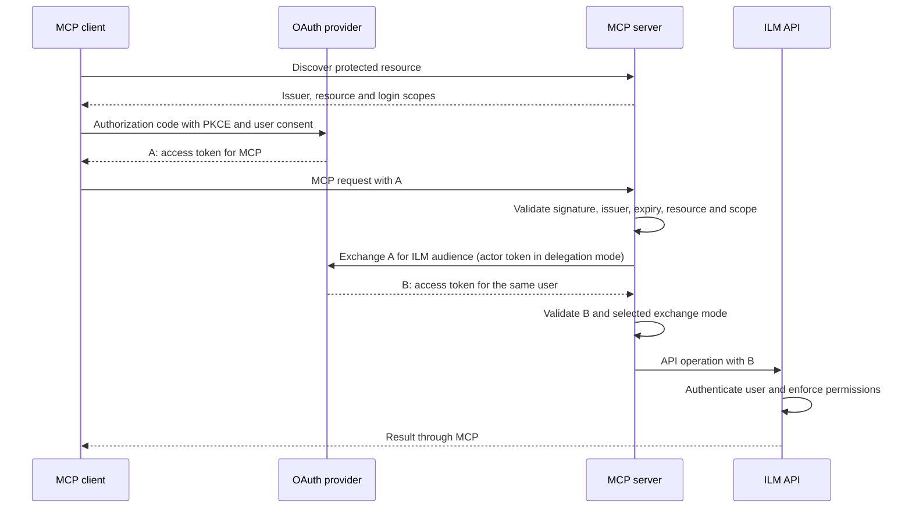

# Shared HTTP authentication

Run a shared MCP server as a stateless OAuth protected resource. Clients sign in with the configured external
identity provider using authorization code and PKCE. The MCP server validates the incoming token, then uses its
own confidential client to exchange it for a separate ILM access token for the same user. ILM enforces that user's
existing roles, object permissions and access policies.

The confidential client credential stays on the server. Public client applications use their own OAuth
registrations and never receive it. User tokens exist only during the active request; MCP stores no user session,
grant, refresh token or token cache. Any replica can handle the next request. The issuer may retain its normal
OAuth login sessions, and clients manage their own login/refresh lifecycle.

## Exchange modes

| Mode | Behavior | Prerequisites |
| --- | --- | --- |
| `standard` | Exchange A for B preserving the user; rejects actor/delegation claims | Issuer supports ordinary token exchange, such as Keycloak Standard Token Exchange V2 |
| `delegation` | Exchange A plus a service-account actor token; B must contain the immediate `act.client_id` matching the configured MCP client | Issuer supports explicit actor delegation and consent; ILM 2.21+ permits the verified delegate |

The mode is an operator setting. A denied exchange, missing actor or unavailable issuer fails the request; there
is no fallback to another mode, direct token forwarding or the MCP service account as the ILM user. Standard mode
preserves the user's authorization but does not provide ILM's delegate allowlist or delegate audit attribution.

Both tokens must be signed by the configured issuer and contain a numeric expiration and nonblank subject. A must
target the exact public MCP resource, have the required scope and exclude the ILM audience. B must target ILM,
exclude the MCP resource and identify the same subject. Returning A unchanged from the token endpoint fails.
Delegation mode additionally validates the immediate actor; standard mode rejects `may_act`/`act` on A and `act`
on B. The server accepts JWT access tokens signed with the configured asymmetric algorithms, not opaque tokens.

## Identity-provider configuration

The application configures a trusted OAuth issuer and endpoints explicitly; provider-specific registration and
permission APIs are outside the shared server. Use the provider's documented token-exchange capabilities and
select the exchange mode explicitly.

1. Confirm the existing ILM OAuth provider and exact issuer. A reserved issuer example is
   `https://identity.example.invalid/tenant`; obtain its signing-key and token endpoints from trusted issuer
   metadata. Reuse the existing ILM provider for that issuer and retain its ILM login client and API audiences.
   A second ILM provider with the same issuer is ambiguous.
2. Register the MCP server as a confidential exchange requester and each user-facing client separately as a
   public authorization-code client with PKCE S256 and its exact installed-client callback. Keep the server
   credential private. Configure the source token for the public MCP resource, for example
   `https://ilm.example.invalid/mcp`, without the ILM API audience.
3. Configure the requester's downstream scopes, audiences and username/role mappings so the exchanged token
   represents the same user for ILM. Restrict any actor-delegation permission to the intended users and requester;
   confirm the deployed ILM version supports and permits that delegate before selecting `delegation`.
4. Validate signed source and exchanged tokens, rejected exchanges and different users' existing ILM permissions
   using the [acceptance checklist](shared-http-acceptance.md) before enabling shared access.

The [Keycloak 26.8.1 integration](keycloak/README.md) is one provider-specific example. Its ordinary Standard V2
flow requires no preview server feature. Its actor-delegation flow additionally requires opt-in server features,
a service account, restricted delegation permission and consent; follow that example's version-pinned prerequisites.

## Server settings

Start the HTTP profile with `SPRING_AI_MCP_SERVER_TYPE=SYNC`,
`SPRING_AI_MCP_SERVER_PROTOCOL=STATELESS`, `ILM_AUTH_METHOD=oauth-delegation` and
`ILM_MCP_SECURITY_ENABLED=true`. Startup rejects incomplete or incompatible shared configurations. The default
HTTP profile remains `STREAMABLE`, so set `STATELESS` explicitly.

| Environment variable | Value or default |
| --- | --- |
| `ILM_API_URL` | Required HTTPS ILM API base, including `/api` |
| `ILM_MCP_SECURITY_ISSUER` | Exact trusted issuer string |
| `ILM_MCP_SECURITY_RESOURCE` | Public HTTPS MCP resource, for example `https://ilm.example.invalid/mcp` |
| `ILM_MCP_SECURITY_JWK_SET_URI` | Trusted HTTPS signing-key endpoint |
| `ILM_MCP_SECURITY_TOKEN_URI` | Trusted HTTPS exchange endpoint |
| `ILM_MCP_SECURITY_CLIENT_ID` | Confidential MCP requester client ID |
| `ILM_MCP_SECURITY_CLIENT_SECRET` | Confidential credential supplied through a Secret reference or private configuration |
| `ILM_MCP_SECURITY_API_AUDIENCE` | `ilm` |
| `ILM_MCP_SECURITY_EXCHANGE_MODE` | `standard` or `delegation`; default `standard` |
| `ILM_MCP_SECURITY_EXCHANGE_SCOPE` | Fixed downstream scope; default empty uses issuer defaults |
| `ILM_MCP_SECURITY_REQUIRED_SCOPE` | `mcp:access` |
| `ILM_MCP_SECURITY_AUTHORIZATION_SCOPES` | Additional comma-separated login scopes; default empty |
| `ILM_MCP_SECURITY_ALLOWED_ORIGINS` | Comma-separated HTTPS browser origins; default empty |
| `ILM_MCP_SECURITY_JWS_ALGORITHMS` | Comma-separated asymmetric allowlist; default `RS256` |
| `ILM_MCP_SECURITY_CONNECT_TIMEOUT` | `5s`; between `100ms` and `60s` |
| `ILM_MCP_SECURITY_READ_TIMEOUT` | `15s`; between `100ms` and `60s` |
| `ILM_MCP_SECURITY_CLOCK_SKEW` | `30s`; between zero and `60s` |
| `ILM_MCP_ACCESS` / `ILM_MCP_TOOLSETS` | `read-only` / `all` |

Supported algorithms are `RS256`, `RS384`, `RS512`, `ES256`, `ES384`, `ES512`, `PS256`, `PS384` and `PS512`.
URLs must be absolute HTTPS without user information or fragments. Chart values require query-free URLs.
Configure the issuer/endpoints explicitly;
request headers and token key URLs cannot select a different issuer or destination. All credential-bearing
requests use TLS verification, bounded timeouts and no redirect following. Use the JVM trust store for private
certificate authorities; shared mode has no TLS verification bypass.

Login scopes and exchange scopes have separate purposes. Protected-resource metadata advertises the required
scope plus `authorization-scopes`; only `required-scope` is the source scope check. For the Keycloak actor flow,
advertise `openid` and `delegation:client:ilm-mcp` in addition to `mcp:access`. The fixed downstream exchange scope
can be `openid ilm-mcp-upstream` to select ILM user/audience mappings. It is never derived from a caller's tool
arguments. MCP requests no refresh token and never stores one returned by an issuer.

The operator access ceiling determines which tools are registered. ILM still decides whether the user may perform
each operation. Sensitive-output tools require `full` as well as the user's permission; ordinary responses omit
protected values. Authenticated errors and upstream parsing failures must not expose tokens, credentials or raw
upstream bodies in client responses or logs. Keep request/body loggers disabled; never collect bearer headers in
ingress access logs or traces.

## Routing and discovery

Publish HTTPS routes for `/mcp` and its subpaths and for
`/.well-known/oauth-protected-resource/mcp`. The root metadata alias
`/.well-known/oauth-protected-resource` returns the same configured resource. Missing/invalid tokens receive a
401 bearer challenge pointing at metadata; insufficient scope receives 403. An unavailable issuer/exchange cannot
become an anonymous request. Every MCP request authenticates, including initialization and tool discovery.

The local public health endpoints are `/actuator/health`, `/actuator/health/liveness` and
`/actuator/health/readiness`; do not publish actuator through the edge. Health checks do not log in or test a
user's permissions. Metadata contains the configured issuer/resource and scopes, never credentials.

Clients without an `Origin` header can connect normally. A supplied browser Origin must match the explicit
allowlist. Allowed preflights permit GET/POST and the supported MCP headers. Do not use wildcard origins or trust
arbitrary forwarded headers to infer resource URLs. Stateless mode requires no session affinity or
`Mcp-Session-Id`; session resumption and durable tasks are not advertised.

## Deployment and acceptance

The [standalone chart](../deploy/README.md) lives with the server under `deploy/charts/mcp-server`.
It supports image tags and digest overrides, requires an existing Secret reference, renders no
credential Secret, and uses explicit ingress/egress policy, non-root containers and no persistent storage. Update
the secret through the deployment's secret manager and roll the pods after credential rotation.

Upgrade every Core replica before saving delegation settings or allowing delegate-bearing audit traffic. Follow
Core's compatible-reader/consistent-restore constraints for rollback. Keep any legacy automatic Keycloak provider
registration disabled when it cannot preserve the delegation fields. Configure the existing persisted realm via
reviewed Admin API changes; a startup realm import is not an update mechanism.

Before enabling shared access, complete the [acceptance checks](shared-http-acceptance.md): real client discovery
and PKCE login, different users' permissions, rejected tokens/exchanges, actor audit behavior, multiple replicas,
restart continuity and redacted failures. Local unit/integration tests or chart installation are not live
identity-provider acceptance. A browserless workload needs its own issuer registration and an ILM-recognized
workload identity; it must pass the same audience/exchange/authorization checks and must not borrow an admin user.

The audience-separated design follows the [MCP security guidance on token passthrough](https://modelcontextprotocol.io/docs/tutorials/security/security_best_practices#token-passthrough)
and [MCP authorization specification](https://modelcontextprotocol.io/specification/latest/basic/authorization).
